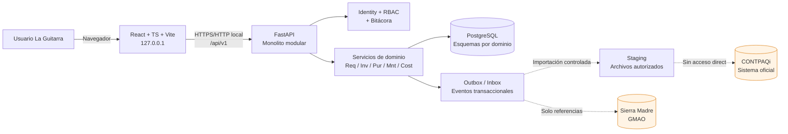
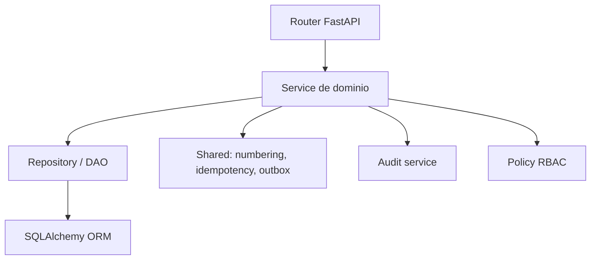
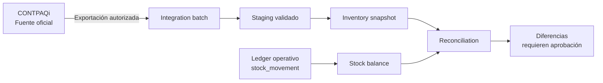
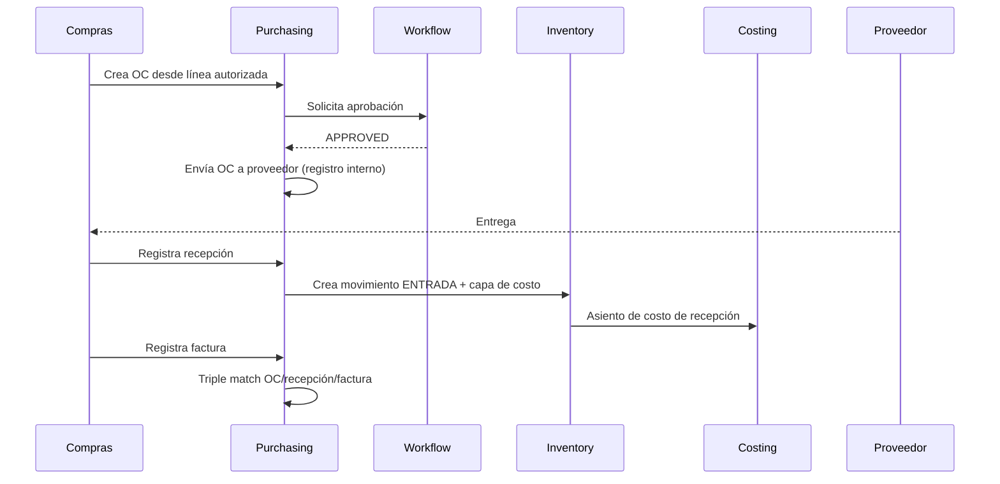

# Arquitectura — ERP MINERO INTEGRAL

**Versión:** 0.1 (diseño)  
**Fecha:** 2026-11-18  
**Estado:** Documento aprobado para iniciar el Lote 1. No implica implementación completa.

---

## 1. Resultado de la inspección inicial

| Aspecto | Hallazgo |
|---|---|
| Ruta física de trabajo | `E:\ERP_MINERO` |
| Ruta indicada en el requerimiento | `C:\ERP_MINERO` (no existe en este entorno) |
| Archivos encontrados | Ninguno, incluyendo ocultos y subdirectorios |
| Prototipo aprovechable | No |
| Repositorio Git | No inicializado |
| Sistemas externos detectados | Ninguno accesible desde este repositorio; no se consultaron |
| Conclusiones | Se parte de cero. No hubo información preexistente que sobrescribir. |

No se crearon enlaces, carpetas de sistema, conexiones ni configuraciones de red. Toda la documentación se generó dentro de `E:\ERP_MINERO`.

---

## 2. Propósito y alcance

Construir un ERP web propio para la unidad minera La Guitarra, inicialmente local y preparado para intranet, con dominios de:

- requisiciones y autorizaciones;
- almacén e inventario operativo;
- compras;
- equipos y mantenimiento;
- costos;
- seguridad RBAC y bitácora.

El sistema **no sustituye** a CONTPAQi ni a Sierra Madre GMAO en esta etapa. CONTPAQi sigue siendo la fuente oficial de inventario/contabilidad; Sierra Madre sigue siendo el GMAO oficial.

---

## 3. Principios arquitectónicos

1. **Monolito modular.** Un solo despliegue FastAPI con módulos desacoplados. Evita complejidad distribuida prematura.
2. **Dominio primero.** La estructura sigue a los bounded contexts, no a pantallas.
3. **Base de datos como guardián de invariantes.** CHECK, UNIQUE, FK y bloqueos complementan—no sustituyen—a la lógica de servicio.
4. **Ledger de inventario.** Los saldos son derivados de movimientos inmutables; la tabla de saldos es una proyección con bloqueo para rendimiento.
5. **Idempotencia.** Cualquier operación sensible puede reintentarse sin duplicar efectos.
6. **Trazabilidad documental.** Número de documento, UUID, evento y auditoría en cada proceso.
7. **Integración pasiva.** No acceso directo a sistemas externos; intercambio controlado y registrado.
8. **Local por diseño.** `127.0.0.1`, sin publicación de puertos.
9. **Aditivo y reversible en documento, no destructivo en datos.** Las correcciones se registran, no borran.
10. **Pruebas como prueba de trabajo.** Sin pruebas, no se declara nada terminado.

---

## 4. Vista general



### Límites de confianza

| Límite | Regla |
|---|---|
| Navegador → API | Autenticación, permisos, validación Pydantic, rate limiting local opcional |
| API → PostgreSQL | Una transacción por caso de uso; sin SQL dinámico sin parámetros |
| API → CONTPAQi | Sin conexión directa. Solo archivos/API autorizados vía staging |
| API → GMAO | Solo lectura controlada o exportación acordada; nunca escritura directa |
| Repositorio → Secretos | Prohibido. Variables de entorno/secret manager |

---

## 5. Estructura propuesta del repositorio

```text
ERP_MINERO/
├── AGENTS.md
├── README.md                         # se crea en Lote 1
├── .gitignore                        # se crea en Lote 1
├── .env.example                      # sin valores reales
├── docs/
│   ├── ARQUITECTURA.md
│   ├── MODELO_DATOS.md
│   ├── PLAN_IMPLEMENTACION.md
│   └── PRIMER_LOTE_OPENCODE.md
├── backend/
│   ├── pyproject.toml
│   ├── alembic.ini
│   ├── migrations/
│   │   ├── env.py
│   │   └── versions/
│   ├── app/
│   │   ├── main.py
│   │   ├── core/                     # config, seguridad, errores, dependencias
│   │   ├── db/                       # base declarativa, sesión, naming convention
│   │   ├── api/v1/routers/
│   │   ├── shared/                   # numbering, idempotency, outbox, pagination
│   │   └── modules/
│   │       ├── identity/
│   │       ├── organization/
│   │       ├── master_data/
│   │       ├── requisitions/
│   │       ├── workflow/
│   │       ├── inventory/
│   │       ├── purchasing/
│   │       ├── maintenance/
│   │       ├── costing/
│   │       ├── integrations/
│   │       └── audit/
│   └── tests/
│       ├── unit/
│       ├── integration/
│       ├── factories/
│       └── conftest.py
└── frontend/
    ├── package.json
    ├── vite.config.ts
    ├── src/
    │   ├── app/                      # router, providers, layout
    │   ├── features/                 # requisitions, inventory, purchases, etc.
    │   ├── components/ui/
    │   ├── lib/                      # api client, auth, query
    │   └── types/
    └── e2e/                          # Playwright
```

---

## 6. Backend

### 6.1 Capas



- **Router:** HTTP, validación de esquema, extracción de usuario autenticado. Sin reglas de negocio.
- **Service:** caso de uso, máquina de estados, invariantes, transacción.
- **Repository:** consultas y persistencia. No decide permisos.
- **Shared:** servicios transversales usados por varios dominios.
- **Audit:** escritura en la misma transacción del caso de uso.

### 6.2 Módulos y responsabilidades

| Módulo | Responsabilidad | No hace |
|---|---|---|
| `identity` | Usuarios, roles, permisos, sesión, alcance RBAC | Definir reglas de compras |
| `organization` | Empresa, unidad minera, departamento, almacén, empleado | Mover stock |
| `master_data` | Artículo, UOM, proveedor, lote, serie, ubicación minera | Autorizar requisiciones |
| `requisitions` | Requisición, líneas, cantidades solicitadas | Decidir aprobaciones |
| `workflow` | Políticas, pasos, decisiones, delegaciones | Ejecutar movimientos de stock |
| `inventory` | Saldos, reservas, movimientos, ajustes, conciliación | EmitirOC |
| `purchasing` | OC, recepciones, facturas, triple match | Publicar contabilidad a CONTPAQi |
| `maintenance` | Equipos, medidores, OT, consumo de materiales | Escribir en GMAO |
| `costing` | Centros/objetos de costo, asientos, capas de valuación | Ser fuente fiscal oficial |
| `integrations` | Staging, mapeos, outbox/inbox, reconcilación | Abrir conexiones a CONTPAQi |
| `audit` | Bitácora y auditoría de acceso | Borrar registros |

### 6.3 Comunicación entre módulos

- Llamadas síncronas mediante interfaces (`InventoryService.reserve_for_requisition()`) dentro de la misma transacción.
- Eventos de dominio persistidos en `intg.outbox_event` para efectos asíncronos.
- Un consumidor local procesa el outbox en el mismo proceso al inicio; en el futuro puede separarse.
- El inbox garantiza idempotencia de eventos recibidos.

---

## 7. Base de datos

### 7.1 Esquemas PostgreSQL

| Esquema | Contenido |
|---|---|
| `seg` | Seguridad |
| `org` | Organización |
| `mdm` | Datos maestros |
| `doc` | Numeración documental |
| `req` | Requisiciones |
| `wfl` | Workflow |
| `inv` | Inventario operativo |
| `pur` | Compras |
| `mnt` | Equipos y mantenimiento |
| `cost` | Costos |
| `intg` | Integraciones y eventos |
| `aud` | Auditoría |

### 7.2 Migraciones

- Alembic con `naming_convention` explícito para índices, FK, UK y CHECK.
- Una migración inicial crea esquemas, `pgcrypto` (para `gen_random_uuid()`) y tablas transversales.
- Cada historia posterior es aditiva por defecto.
- `downgrade` solo se usa en desarrollo local; en producción se requiere plan de compensación.
- Antes de `head`, la prueba de migración corre desde una base vacía y verifica las restricciones críticas.

### 7.3 Estrategia de inventario



- `stock_balance` marca existencia operativa, **no oficial**.
- `intg.external_system.official_inventory = true` solo para CONTPAQi.
- Ningún movimiento del ERP se publica automáticamente a CONTPAQi.
- Las diferencias se concilian con snapshots; nunca se “corrige” borrando movimientos.

---

## 8. Seguridad y auditoría

- Autenticación local inicial con usuario/contraseña hasheada; preparado para OIDC futuro.
- RBAC con permisos por acción y alcance opcional.
- Matriz de permisos cargada por migración semilla con datos sintéticos.
- Middleware agrega `request_id` y actor a cada petición.
- Servicio de auditoría escribe `aud.audit_log` en la misma transacción.
- Eventos sensibles: login, cambio de rol, aprobación, recepción, entrega, ajuste, reversión, carga de archivo.
- Logs sin contraseñas, tokens, números de tarjeta ni datos personales innecesarios.
- IP se almacena hasheada si se requiere evidencia.

### Permisos iniciales representativos

```text
requisition.create
requisition.submit
requisition.approve
requisition.cancel
inventory.reserve
inventory.issue
inventory.receive
inventory.adjust
inventory.reconcile
purchase.order.create
purchase.order.approve
purchase.receive
equipment.view
equipment.edit
workorder.create
cost.post
cost.reverse
integration.batch.upload
audit.view
admin.users.manage
```

---

## 9. Flujos clave

### 9.1 Requisición con entrega desde almacén

```mermaid
sequenceDiagram
    participant U as Solicitante
    participant API
    participant REQ as Requisitions
    participant WFL as Workflow
    participant INV as Inventory
    participant COST as Costing
    participant AUD as Audit

    U->>API: Crea requisición
    API->>REQ: Crea cabecera + líneas (DRAFT)
    REQ->>AUD: Registra creación
    U->>API: Envía a autorización
    API->>REQ: SUBMITTED
    REQ->>WFL: Crea approval_request
    WFL-->>REQ: decisiones por línea (authorized_qty)
    REQ->>REQ: APPROVED / PARTIAL / REJECTED
    U->>API: Solicita entrega
    API->>INV: reserve_for_requisition()
    INV->>INV: FOR UPDATE saldo; valida disponible
    INV->>INV: Crea reserva
    API->>INV: issue_for_requisition()
    INV->>INV: Consume reserva + movimiento SALIDA
    INV->>COST: Crea cost_posting
    INV->>AUD: Registra entrega
    COST-->>API:.delivered_qty actualizado
```

### 9.2 Compra y recepción



---

## 10. Frontend

- SPA React + TypeScript con Vite.
- Rutas por dominio: `/requisiciones`, `/almacen`, `/compras`, `/equipos`, `/costos`, `/admin`.
- Componentes de formulario derivation de esquemas Pydantic/OpenAPI cuando sea práctico.
- Estado de servidor con TanStack Query; estado global mínimo para sesión.
- Tablas con paginación, filtros y ordenamiento en servidor.
- Opción offline: no en Lote 1. Si se requiere, diseñar cola local con idempotencia.
- Accesibilidad básica desde el inicio: etiquetas, foco, contraste y mensajes de error.

---

## 11. No funcionales

| Requisito | Decisión |
|---|---|
| Exposición | Solo `127.0.0.1`; intranet futura mediante proxy autorizado |
| Zona horaria | Almacenamiento UTC; presentación `America/Mexico_City` |
| Auditoría | Retención definida por política; no borrado automático sin aprobación |
| Concurrencia | Bloqueo pesimista en saldos; optimistic locking en documentos |
| Observabilidad | Logs estructurados con `request_id`; métricas locales después del Lote 1 |
| Respaldo | Fuera del alcance de este diseño; no se configuró infraestructura |
| Internacionalización | Español de México; moneda MXN por defecto |
| Accesibilidad | WCAG 2.1 AA como objetivo progresivo |

---

## 12. Decisiones arquitectónicas

| ID | Decisión | Justificación | Consecuencia |
|---|---|---|---|
| ADR-001 | Monolito modular FastAPI | Equipo pequeño, dominio complejo, despliegue local | Extraer módulos solo si hay evidencia |
| ADR-002 | Esquemas PostgreSQL por dominio | Límites claros sin bases múltiples | Cross-schema FK controlados |
| ADR-003 | Inventario como ledger + proyección | Trazabilidad y conciliación | Requiere bloqueos e idempotencia |
| ADR-004 | CONTPAQi permanece oficial | Evita segundo inventario oficial | El ERP es operativo hasta decisión formal |
| ADR-005 | Sin conexión directa a sistemas externos | Cumple restricción y reduce riesgo | Intercambios inicialmente manuales/controlados |
| ADR-006 | UUID + número de documento | Estabilidad técnica + legibilidad humana | Dos identificadores complementarios |
| ADR-007 | Migraciones aditivas | Protección de información preexistente | Correcciones vía compensación |

---

## 13. Riesgos principales

Resumen; el detalle está en `docs/PLAN_IMPLEMENTACION.md`.

| Riesgo | Impacto | Mitigación principal |
|---|---|---|
| Doble inventario oficial | Alto | Registro de autoridad, snapshots y conciliación |
| Acceso indebido a CONTPAQi | Alto | Prohibición de conexión directa; staging con hash |
| Escritura accidental en GMAO | Alto | Adaptador sin credenciales de escritura; solo referencias |
| Concurrencia sobre saldos | Alto | `FOR UPDATE`, idempotencia, pruebas de carrera |
| Datos reales en pruebas | Alto | Semillas sintéticas y revisión de diffs |
| Permisos demasiado amplios | Medio-Alto | RBAC con alcance y bitácora |
| Migraciones destructivas | Alto | Política aditiva y revisión obligatoria |
| Alcance excesivo | Medio | Lotes pequeños con criterios de salida |

---

## 14. Estado actual y siguiente paso

**Implementado en este momento:** únicamente documentación de arquitectura, modelo de datos, plan y reglas.

**No implementado:** código, esquemas físicos, endpoints, UI, migraciones ejecutadas, integraciones.

**Siguiente paso:** ejecutar el `PRIMER_LOTE_OPENCODE.md`, que termina con una base técnica verificable sin poner en producción ningún flujo de inventario.
