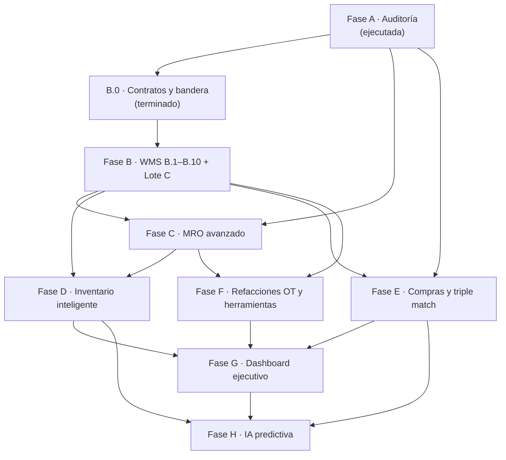

# ERP MINERO INTEGRAL — Dependencias, orden de implementación y puertas de aprobación

> Fase A — auditoría de cobertura funcional y modelo de datos.
>
> Fecha: 2026-11-19
>
> Línea base: HEAD real `4a493b8` (`Agrega contratos, permisos y bandera del Lote B WMS`).
>
> Alcance: **solo documentación**. No se modificó código, no se aplicaron migraciones, no se hizo push ni despliegue.
>
> Documentos relacionados: `ERP_MRO_WMS_PLAN_MAESTRO.md`, `ERP_MRO_WMS_MATRIZ_FUNCIONAL.md`.

---

## 1. Principios de ordenamiento

1. **La fuente de verdad es el movimiento append-only.** Ninguna fase posterior puede convertir una proyección (`inv.stock_balance`, `inv.stock_balance_detail`, KPIs) en hecho contable.
2. **Primero transaccionalidad, después inteligencia.** No se calculan indicadores ni recomendaciones sobre movimientos que aún no son atómicos, idempotentes y auditables.
3. **Primero contrato, después implementación.** Un lote no puede usar un permiso, esquema Pydantic o nombre de tabla que no exista en la revisión anterior.
4. **Una puerta no aprobada bloquea solo la operación dependiente**, no el lote completo; se continúa con las actividades independientes y seguras y se reporta el bloqueo.
5. **Compatibilidad hacia atrás.** Los 55 endpoints actuales, las claves de idempotencia existentes y la cadena Alembic hasta `a1b2c3d4e5f6` se conservan.
6. **Migraciones aditivas.** Sin `DROP`, `TRUNCATE`, `DELETE` masivo, `downgrade` sobre datos reales ni backfill automático.
7. **Verificación en PostgreSQL real.** Nunca se afirma una prueba transaccional o de concurrencia con SQLite.
8. **Datos sintéticos.** Sin conexión a CONTPAQi ni escritura en GMAO; sin exponer servicios fuera de `127.0.0.1`.

---

## 2. Grafo de dependencias entre fases



**Ruta crítica:** A → B.0 → B (B.1…B.10) → D → G → H.
La Fase C puede avanzar en paralelo a B una vez cerrados B.2 y B.4; la Fase E puede preparar RFQ/comparativos en paralelo, pero el triple match depende de B.3.

---

## 3. Dependencias detalladas por fase

| Fase | Requiere (entradas) | Produce (salidas) | Bloqueada por | Puede avanzar en paralelo con |
|---|---|---|---|---|
| **A** (ejecutada) | Repositorio y documentación existentes. | Plan maestro, matriz funcional, este documento. | — | — |
| **B** | A, B.0, Lote A, decisiones D-01…D-05, esquema D-06, política D-07 y jerarquía D-08. | Movimientos WMS atómicos: entradas, salidas, devoluciones, cuarentena, reversos, kardex y reconciliación; luego Lote C. | D-01…D-05, D-06, D-07, D-08 | Preparación de C (modelo de datos), diseño de E (RFQ), diseño de KPIs. |
| **C** | B.2 (repositorio/saldos) y B.4 (snapshot de equipo/OT); D-08 jerarquía; D-10 si se vincula OT. | Catálogo MRO enriquecido, equivalencias, compatibilidad, obsoletos, sustitutos y detección de duplicados. | Declaración de jerarquía MRO y de reglas de aprobación de equivalencias. | B.5–B.10, diseño de D, diseño de F. |
| **D** | B completo (hechos confiables), consumos históricos sintéticos autorizados, umbrales aprobados. | Indicadores calculados, alertas, ABC/XYZ, cobertura e inmovilizados con contrato de metadatos. | Disponibilidad de histórico y aprobación de umbrales; no se inventan valores. | E, F. |
| **E** | B.3 (recepciones enriquecidas), D-11 tolerancias y aprobador, D-12 canal CFDI, D-07 valuación. | RFQ, comparativos, OC, triple match, devoluciones a proveedor, compromisos de gasto. | D-11, D-12, D-07 | D, F, preparación de G. |
| **F** | B.4 (salidas con equipo/OT), C (compatibilidad), D-09 modelo herramienta, D-10 modelo OT. | Refacciones por OT, costo por OT/equipo, control de herramientas y calibraciones. | D-09, D-10 | D, E. |
| **G** | B, D, E, F y contratos de KPI con fórmula/fuente/período/filtros. | Paneles por rol y documento `DASHBOARD_KPIS.md`. | Que existan las fuentes; si no, mostrar SIN DATOS. — | Documentación de KPIs puede redactarse antes. |
| **H** | D, E, G, volumen histórico autorizado y política de aprobación humana. | Reglas deterministas, explicaciones y recomendaciones sin ejecución autónoma. | Histórico suficiente y control técnico de no escritura. | Revisión de reglas ya documentadas. |

### 3.1 Propiedades del grafo

- **No hay ciclos entre fases A–H.** Las flechas apuntan siempre de una fase de menor número a una de mayor número, salvo C/E/F que pueden solaparse con B pero no retroceden.
- **B es el cuello de botella:** 5 fases dependen directa o indirectamente de que el movimiento WMS sea correcto.
- **H es terminal:** nada posterior depende de IA; la IA nunca alimenta automáticamente inventario ni compras.
- **G es agregación pura:** no debe escribir en `inv`, `pur`, `req` ni `mnt`.

---

## 4. Dependencias internas de la Fase B (Lote WMS B)

Fuente: `docs/WMS_LOTE_B_PLAN.md` §2 y §4. Estado real verificado: **B.0 terminado**; B.1–B.10 pendientes.

| Lote | Nombre | Depende de | Bloquea | Nota de dependencia |
|---|---|---|---|---|
| B.0 | Contratos y bandera | — | B.1 | Terminado: permisos, aliases, `WMS_LOTE_B_ENABLED=False`, 5 esquemas Pydantic, 9 pruebas. |
| B.1 | Migración aditiva | B.0, D-06 | B.2 | `down_revision = a1b2c3d4e5f6`. Sin backfill automático. Si D-06 no está aprobada, crear solo objetos `inv`. |
| B.2 | Modelos y repositorio | B.1 | B.3–B.7 | `StockBalanceDetail`, órdenes/tareas, bloqueos deterministas; sin endpoints. |
| B.3 | Entradas | B.2, D-03, D-06 | B.4 | Extender `receive_stock()` sin romper `PurchasingService.receive()` ni `CostLayer`. |
| B.4 | Salidas | B.3, D-03, D-05 | B.5, C, D, F | Doble barrera anti duplicado, `delivery_seq`, snapshot equipo/OT/centro de costo. |
| B.5 | Devoluciones y cuarentena | B.4, D-01, D-02 | B.6 | Devolución vs reverso: solo el reverso descuenta `line_delivered_qty` según diseño. |
| B.6 | Reversos e inmutabilidad | B.5 | B.7 | Confiar en triggers de B.1; sin endpoint de edición/borrado. |
| B.7 | Kardex y reconciliación | B.6 | B.8 | `inv.v_kardex`, `balances`, `reconciliation`; cero divergencia agregado/detalle. |
| B.8 | Auditoría, permisos y alcance | B.7, DU-06 resuelta | B.9 | `require_permission`, `AuditService.record`, filtro por compañía/unidad/departamento/almacén. |
| B.9 | Frontend mínimo | B.8 | B.10 | Cliente tipado desde OpenAPI; sin `fetch` directo ni secretos en `localStorage`. |
| B.10 | Verificación final | B.9 | Lote C | Regresión 77 pruebas backend + 25 frontend; `empty→head`; portal smoke; commit local. |
| C (WMS) | Traspasos, transferencias, tránsito, conteos, ajustes | B.10, D-08 | D (inventario inteligente) | Requiere jerarquía de ubicación aprobada. |

### 4.1 Regla de ejecución de B.1 si D-06 no está aprobada

Si no existe aprobación explícita del esquema físico `wms`, **no crear ese esquema**. El lote B.1 se limita a objetos en `inv`:

- `inv.stock_balance_detail`;
- columnas enriquecidas en `inv.stock_movement` (lote/serie/ubicación referenciados, estado, grupo de movimiento, secuencia);
- índices parciales y `CHECK`/trigger de inmutabilidad, reverso duplicado y reconciliación;
- vistas de kardex y de reconciliación;
- función manual `inv.backfill_lote_b_detail()` sin ejecución automática.

Las tablas `wms.movement_order`, `wms.movement_order_line` y `wms.movement_task` se posponen y se reportan como bloqueadas. Esta regla resuelve la contradicción CO-02 documentada en la matriz funcional.

---

## 5. Puertas de decisión

Ninguna puerta está aprobada en el repositorio. “Pendiente” significa **no implementar la operación dependiente**.

| ID | Decisión | Estado | Bloquea | Impacto si se asume |
|---|---|---|---|---|
| D-01 | ¿Las devoluciones descuentan `line_delivered_qty`? (diseño: no; solo reversos) | Pendiente | B.5, B.6, F | Doble descuento de surtido o cantidades inconsistentes entre requisición y kardex. |
| D-02 | Autorizador formal para liberación de cuarentena | Pendiente | B.5, B.8 | Liberación sin autoridad formal; auditoría incompleta. |
| D-03 | `expiry_date` vencida: ¿bloquea o solo advierte? | Pendiente | B.3, B.4 | Salida de material vencido o paro operativo no previsto. |
| D-04 | Cuándo ejecutar `inv.backfill_lote_b_detail()` en el piloto | Pendiente | B.1, B.10, inicio de piloto | Proyecciones vacías o backfill sobre datos no autorizados. |
| D-05 | FEFO vs FIFO por familia de artículo | Pendiente | B.4, D | Selección incorrecta de lotes; sesgo en consumo y valuación. |
| D-06 | Esquema físico `wms` vs esquemas `inv`/`mdm` actuales | Pendiente | B.1, B.2, B.3 | Migración sobre esquema no autorizado; contradicción con el plan B. |
| D-07 | Política de valuación y aprobadores de diferencias/reversiones | Pendiente | B/F/E | Costos duplicados o reversiones sin responsable; triple matchincoherente. |
| D-08 | Jerarquía de ubicación y reglas de mezcla por lote/serie | Pendiente | B, C, Lote C WMS | Ubicaciones ambiguas, mezcla de lotes incompatibles. |
| D-09 | Modelo de herramientas (activo / consumible / retornable; `mnt` vs WMS) | Pendiente | F | Catálogo paralelo de herramientas; responsable y calibración sin dueño. |
| D-10 | Modelo OT: entidad local vs solo `work_order_no` externo GMAO | Pendiente | F, B.4 | Invención de entidad OT o imposibilidad de costo por OT. |
| D-11 | Tolerancias y aprobador de triple match | Pendiente | E | Pago con diferencias no aprobadas o rechazos arbitrarios. |
| D-12 | Formato/canal CFDI con CONTPAQi y momento de prueba LAN | Pendiente | E | Exposición de datos fiscales o conexión no autorizada a CONTPAQi. |

### 5.1 Registro formal requerido

Para marcar una puerta como aprobada, el repositorio debe contener un documento o ticket con:

- identificador de la puerta (D-01…D-12);
- decisión textual exacta;
- rol aprobador y fecha;
- alcance (qué lotes habilita);
- referencia al commit que la implementa.

Una mención en una conversación, un correo no versionado o un supuesto del implementador **no** constituye aprobación.

---

## 6. Compatibilidad y contratos que no se rompen

| Contrato | Regla para todos los lotes |
|---|---|
| Endpoints existentes | No eliminar ni cambiar la semántica de los 55 endpoints actuales. Las extensiones usan parámetros opcionales con `None` por defecto. |
| Claves de idempotencia | No reutilizar ni modificar las claves actuales de reservas, movimientos y recepciones. |
| Notación de lotes/series | `lot_id`/`location_id` centinela se conservan; la dimensión canónica es `*_ref_id` y, desde B.1, `stock_balance_detail`. |
| Numeración | `doc.document_registry` sigue siendo la autoridad; no generar folios paralelos. |
| Alembic | Cadena actual hasta `a1b2c3d4e5f6`; toda revisión nueva es aditiva con `down_revision` correcto. |
| RBAC | `canonical_permission()` y los alias heredados se conservan; `audit.view_all` (DU-06) se regulariza, no se elimina silenciosamente. |
| Dinero y cantidades | `NUMERIC(18,6)` / `NUMERIC(18,2|4)`; prohibido `float`. |
| Red | Solo `127.0.0.1`; sin `0.0.0.0`, firewall, publicación de puertos ni LAN. |
| Sistemas externos | CONTPAQi y GMAO intactos; integraciones futuras por staging/autorización. |

---

## 7. Matriz de impacto por esquema

| Esquema | Fase B | Fase C | Fase D | Fase E | Fase F | Fase G | Fase H |
|---|---|---|---|---|---|---|---|
| `seg` | RBAC B.8 | — | — | — | — | — | — |
| `org` | Filtro de alcance | — | — | — | — | Filtros de panel | — |
| `mdm` | Validación lote/serie/ubicación | Columnas y tablas nuevas MRO | Parámetros de reposición | Proveedor/lead time | Compatibilidad equipo | — | Snapshot de entrada |
| `doc` | Numeración de movimientos | Historial de catálogo | — | Factura/CFDI staging | — | — | — |
| `req` | Snapshot surtido | Búsqueda MRO | — | Origen de OC | Asociación OT | — | — |
| `wfl` | Aprobación cuarentena/reverso | Aprobación equivalencias | — | Aprobación por importe/tolerancia | Aprobación préstamo | — | Decisión humana |
| `inv` | **Núcleo** (saldos, detalle, movimientos, vistas) | solo lectura | solo lectura | recepciones | consumo | solo lectura | **prohibida escritura** |
| `pur` | recepción enriquecida | — | — | **Núcleo** | — | — | **prohibida escritura** |
| `mnt` | equipo en movimiento | compatibilidad | criticidad | — | **Núcleo** | — | — |
| `cost` | capas por recepción | — | valuación | triple match | costo OT/equipo | valorizado | — |
| `intg` | outbox de movimientos | — | — | staging CFDI | eventos GMAO | — | recomendaciones |
| `aud` | bitácora de movimientos | bitácora de catálogo | — | bitácora de compras | bitácora de préstamos | — | decisión humana |

> Regla crítica: las fases G y H nunca escriben en `inv` ni `pur`. Si una recomendación requiere un cambio, debe pasar por un documento aprobado y por el servicio correspondiente, con auditoría.

---

## 8. Riesgos de dependencia y mitigaciones

| Riesgo | Fases afectadas | Mitigación |
|---|---|---|
| B.1 crea esquema `wms` sin aprobación | B, C | Aplicar §4.1; verificar D-06 antes de ejecutar Alembic. |
| Doble registro del hecho físico entre recepción de compras y entrada WMS | B.3, E | Una recepción = un `RECEIPT` + un `CostLayer`; DU-11; prueba de regresión de compras. |
| Saldo agregado y detalle divergentes | B.1–B.10, D, G | Restricción deferida de reconciliación y reporte `reconciliation`; prueba C-series. |
| Bloqueos en orden inverso → deadlock | B.2–B.6 | Orden determinista agregado → detalle → maestros; prueba con dos scopes invertidos. |
| Permiso fantasma `audit.view_all` | B.8, G | Regularizar DU-06 con prueba RBAC antes de cablear auditoría nueva. |
| KPIs con fuentes aún no implementadas | G | Contrato `value|null`, `status=SIN DATOS`; nunca estimar. |
| IA sin histórico suficiente | H | Abstención explícita; reglas deterministas primero; sin escritura autónoma. |
| PostgreSQL inestable | Todas | Verificar servicio antes de pruebas; el incidente `0xC0000409`/`pg_control` de B.0 quedó documentado. |
| Base `erp_minero_pilot` inexistente | B.10 y piloto | Requiere autorización administrativa y rol `CREATEDB`; no crear en Fase A. |
| Documentación base desactualizada | Todas | `ARQUITECTURA.md` §14, `README.md`, `PRUEBAS_PORTAL.md`, `WMS_LOTE_B_PLAN.md:5`; prevalece Git y esta matriz. |

---

## 9. Orden de implementación recomendado (secuencia verificable)

1. **Puertas D-06 y D-07** — confirmar por escrito antes de B.1. Si D-06 no está aprobada, ejecutar el alcance reducido de §4.1.
2. **B.1** — migración aditiva sobre base sintética; prueba `empty→head`.
3. **B.2** — repositorio y bloqueos; pruebas de concurrencia.
4. **B.3 + B.4** — entradas y salidas; regresión de compras.
5. **D-01…D-05** — resolver antes de B.5; si alguna sigue pendiente, implementar solo las partes independientes.
6. **B.5–B.8** — devoluciones, cuarentena, reversos, kardex, auditoría y RBAC.
7. **B.9–B.10** — frontend mínimo y verificación completa; luego Lote C.
8. **C** — catálogo MRO avanzado (puede iniciarse el diseño desde el paso 4).
9. **D y E** — inventario inteligente y compras completas (E requiere D-11/D-12).
10. **F** — refacciones por OT y herramientas (requiere D-09/D-10).
11. **G** — dashboard con contrato de KPI.
12. **H** — IA predictiva con reglas verificables y aprobación humana.

---

## 10. Criterios de aceptación de fase (resumen)

El detalle completo está en `ERP_MRO_WMS_PLAN_MAESTRO.md` §4. Cada fase debe cumplir, como mínimo:

| Fase | Criterio verificable clave |
|---|---|
| A | Tres documentos creados; HEAD real verificado; sin cambios de código ni push. |
| B | Agregado y detalle reconcilian a cero; un movimiento por intención; idempotencia, auditoría y evento en la misma transacción; escenarios C01–C20 en verde; bandera apagada hasta autorización. |
| C | Un código interno por artículo; equivalencias/sustitutos con aprobación explícita; historial inmutable; cero sustitución automática. |
| D | Indicadores reproducibles desde movimientos; predicciones etiquetadas; SIN DATOS sin histórico; ningún indicador modifica stock. |
| E | Ninguna factura se liquida sin OC + recepción + match; diferencias con aprobador formal; CFDI solo por staging autorizado. |
| F | Sin entidad OT inventada sin aprobación; retornables y consumibles separados; cero escritura en GMAO. |
| G | Todo KPI con fórmula, fuente, período y filtros documentados; SIN DATOS cuando falte información; portal smoke en verde. |
| H | IA no autoriza compras ni mueve inventario; recomendación con explicación, versión y evidencia; disposición humana auditada. |

**Definición de terminado común:** lint y type-check limpios; pruebas nuevas y existentes en verde con PostgreSQL real cuando haya transacciones; migración aditiva probada `empty→head`; sin secretos ni datos reales en el diff; bitácora de acciones sensibles; documentación actualizada; limitaciones y siguiente lote indicados; commit local verificado, sin push.

---

## 11. Instrucción para el siguiente lote de OpenCode

**Lote siguiente: Fase B — Lote B.1 (migración aditiva), condicionado a D-06.**

```text
Trabaja en E:\ERP_MINERO. Lee AGENTS.md, docs/ERP_MRO_WMS_PLAN_MAESTRO.md,
docs/ERP_MRO_WMS_MATRIZ_FUNCIONAL.md, docs/ERP_MRO_WMS_DEPENDENCIAS.md y
docs/WMS_LOTE_B_PLAN.md antes de cambiar código.

Verificación inicial obligatoria:
1. Confirma con git log que HEAD es 4a493b8 o posterior y que git status está limpio.
2. Confirma que WMS_LOTE_B_ENABLED=False y que no existen rutas /api/v1/wms/movements.
3. Confirma que la decisión D-06 (esquema físico wms) está aprobada por escrito.
   Si NO está aprobada, aplica el alcance reducido del documento de dependencias:
   crea solo objetos en inv (stock_balance_detail, columnas de stock_movement,
   índices parciales, triggers de inmutabilidad/reverso/reconciliación, vistas
   de kardex y reconciliación y función manual inv.backfill_lote_b_detail()).
   No crees tablas en el esquema wms y reporta el bloqueo.

Implementa:
4. Crea backend/migrations/versions/b7c8d9e0f1a2_lote_b_movimientos_wms.py con
   down_revision = a1b2c3d4e5f6. Solo DDL aditivo; downgrade() lanza RuntimeError.
5. No ejecutes backfill automático, no modifiques datos y no toques CONTPAQi/GMAO.
6. Crea backend/tests/integration/test_migration_lote_b.py con inspección de
   objetos creados, UPDATE/DELETE de movimiento que debe fallar, reverso duplicado
   que debe fallar y COMMIT con divergencia agregado/detalle que debe fallar.
7. Ejecuta la migración únicamente sobre la base sintética de pruebas y ejecuta
   pytest, ruff y mypy. No uses SQLite. No hagas push.
8. Crea docs/WMS_LOTE_B1_RESULTADOS.md con objetos creados, pruebas ejecutadas,
   decisiones pendientes D-01...D-05 y siguiente lote B.2.
9. Haz un commit local en español, imperativo y específico. Sin push.

Detén solamente la operación que dependa de una decisión no aprobada y continúa
con las actividades independientes y seguras. No declares el Lote B completo.
```

---

## 12. Limitaciones conocidas

- `erp_minero_pilot` no existe; verificar `empty→head` requiere autorización administrativa y rol con `CREATEDB`.
- No hay CI; todas las verificaciones son locales.
- Las cinco decisiones del Lote B y las siete puertas adicionales siguen sin aprobación documentada.
- El incidente PostgreSQL de B.0 (`0xC0000409`, `PANIC: no se pudo abrir global/pg_control`) requiere comprobar estabilidad del servicio antes de ejecutar pruebas.
- Fase A no ejecutó pruebas: no hubo cambios de código que verificar. La línea base de referencia (77 backend, 25 frontend) proviene de la evidencia existente, no de una ejecución realizada en esta entrega.
