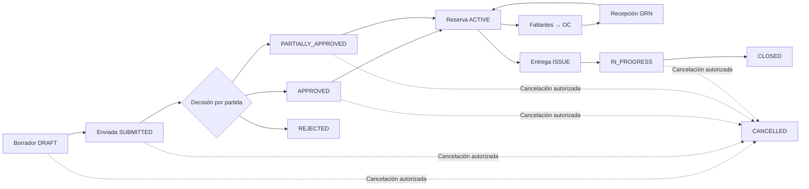

# Flujo integral de requisiciones — Fase 4

**Fecha:** 2026-11-18
**Aplica a:** `E:\ERP_MINERO`, backend FastAPI `/api/v1` y portal React.
**Estado del documento:** describe el comportamiento implementado y verificado localmente. El triple match con factura sigue pendiente; ver `FASE4_RESULTADOS.md` §7.

---

## 1. Visión general

El circuito nace de un documento con folio único y termina cuando todas sus partidas están entregadas o canceladas. Cada cambio relevante queda registrado en la bitácora, en el evento de documento y en el `outbox` dentro de la misma transacción.



Reglas de oro:

1. El inventario del ERP es **operativo**; CONTPAQi sigue siendo el inventario oficial.
2. Toda existencia, reserva, entrega y recepción se ejecuta en una transacción con bloqueo y clave de idempotencia persistida.
3. Movimientos y decisiones son **append-only**: las correcciones son contrapartidas o reversiones, nunca borrados.
4. No se publican asientos a CONTPAQi ni se escribe en GMAO. La OT se guarda solo como referencia textual.

## 2. Estados

### Requisición

| Estado | Significado | Transiciones permitidas |
|---|---|---|
| `DRAFT` | Borrador editable por autor/admin | `SUBMITTED`, `CANCELLED` |
| `SUBMITTED` | Pendiente de autorización | `APPROVED`, `PARTIALLY_APPROVED`, `REJECTED`, `CANCELLED` |
| `APPROVED` | Todas las partidas vigentes autorizadas | `IN_PROGRESS`, `CANCELLED`, `CLOSED` |
| `PARTIALLY_APPROVED` | Al menos una partida autorizada; las omitidas o rechazadas se cancelan | Igual que `APPROVED` |
| `REJECTED` | Sin partidas autorizadas; requiere motivo | Terminal |
| `IN_PROGRESS` | Al menos una entrega parcial registrada | `CLOSED`, `CANCELLED` |
| `CLOSED` | Todas las partidas entregadas o canceladas | Terminal |
| `CANCELLED` | Cancelación autorizada por otro responsable; libera reservas | Terminal |

### Partida

| Estado | Significado |
|---|---|
| `OPEN` | Borrador, sin decisión |
| `AUTHORISED` | Autorizada en su totalidad |
| `PARTIAL` | Autorizada parcialmente |
| `CANCELLED` | Rechazada, omitida o cancelada |
| `CLOSED` | Conciliada al entregarse en su totalidad |

### Reserva

`ACTIVE` → `CONSUMED` (entrega total) | `RELEASED` (cancelación/rechazo) | `EXPIRED` (vencimiento a 7 días).

### Orden de compra

`DRAFT` → `APPROVED` → `SENT` → `PARTIALLY_RECEIVED` → `RECEIVED` → `CLOSED`. `CANCELLED` desde `DRAFT`, `APPROVED` o `SENT`; cancela las líneas pendientes y devuelve el faltante.

## 3. Captura (PASO 2)

`POST /api/v1/requisitions` · permiso `requisition.create` · respuesta `201`.

```json
{
  "department_id": "...",
  "warehouse_id": "...",
  "equipment_id": "...",
  "cost_center_id": "...",
  "requisition_type": "STOCK",
  "priority": "NORMAL",
  "justification": "Reposición de materiales para turno",
  "observations": "Referencia opcional",
  "needed_at": "2026-11-25T10:00:00Z",
  "work_order_no": "OT-GMAO-0042",
  "lines": [
    {
      "item_id": "...",
      "description": "Tornillo M8 x 30 (demo)",
      "uom_id": "...",
      "requested_qty": "10.000000",
      "notes": "Uso en excavadora"
    }
  ]
}
```

- Compañía y unidad minera se derivan del departamento; no se aceptan valores del cliente.
- Almacén, centro de costo, equipo y artículos se validan contra la compañía; las requisiciones `STOCK` exigen almacén.
- `priority`: `LOW`, `NORMAL`, `HIGH` (Alta), `URGENT` (Crítica). No hay aprobación automática por importe.
- `line_no` es consecutivo desde 1; `requested_qty` es `NUMERIC(18,6)` estrictamente positivo; se rechazan descripciones de menos de 2 caracteres y partidas vacías.
- Folio `REQ-LAG-AAAA-NNNNNN` emitido por `doc.document_numbering`; el registro de documento queda vinculado a la requisición.
- `PATCH /api/v1/requisitions/{id}/draft` permite editar encabezado y, si se envía `lines`, reemplazar las partidas; solo en `DRAFT` y por autor/admin. `lines` es opcional para conservar compatibilidad.
- Adjuntos: `POST /{id}/attachments` (multipart `file`), `GET /{id}/attachments` y `GET /{id}/attachments/{attachment_id}/download`. Solo PDF/JPG/PNG, máximo 5 MiB, contenido en `var/attachments/<requisition_id>/`, SHA-256 en la base.

## 4. Envío y autorización (PASO 3)

`POST /api/v1/requisitions/{id}/submit` · permiso `requisition.submit` · solo autor/admin y estado `DRAFT`.

Crea `wfl.approval_request` y un `wfl.approval_step` con `role_code = APROBADOR`, `step_no = 1`, `status = PENDING`.

`POST /api/v1/requisitions/{id}/decide` · permiso `requisition.approve` · cuerpo:

```json
{
  "decisions": [
    { "requisition_line_id": "...", "decision": "APPROVE", "approved_qty": "8.000000" },
    { "requisition_line_id": "...", "decision": "REJECT", "reason": "Artículo no disponible" }
  ],
  "reason": "Aprobación parcial por disponibilidad"
}
```

Controles aplicados antes de cualquier escritura:

- La requisición debe estar `SUBMITTED`.
- Quien decide **no** puede ser el solicitante (`403`).
- Debe tener acceso al departamento y un rol en `APPROVER_ROLE_CODES` = `{ADMIN, APROBADOR, JEFE_DEPARTAMENTO}` (`403`).
- Debe existir una solicitud y un paso pendientes; la fila, la solicitud, el paso y las partidas se bloquean con `FOR UPDATE` (`409` si no).
- No se admiten partidas duplicadas ni ajenas a la requisición.
- `REJECT` exige motivo (`422`); `APPROVE` no puede exceder `requested_qty - cancelled_qty`.
- Las partidas omitidas se cancelan automáticamente y cuentan como rechazadas para el estado global.

Estado resultante: `REJECTED` si no queda cantidad autorizada; `APPROVED` si se autorizó todo lo vigente; en otro caso `PARTIALLY_APPROVED`. Se registran actor, `decided_at`, motivo, evento de documento, auditoría y outbox.

`GET /api/v1/requisitions/{id}/history` · permiso `requisition.history.view` · devuelve la cronología de eventos con transiciones `from_status → to_status` y timestamp.

## 5. Disponibilidad y reserva (PASO 4)

`GET /api/v1/inventory/availability?item_id=...&warehouse_id=...` devuelve `on_hand_qty`, `reserved_qty` y `available_qty = on_hand - reserved`.

`POST /api/v1/inventory/reservations` · permiso `inventory.reserve`:

```json
{
  "requisition_line_id": "...",
  "quantity": "4.000000",
  "idempotency_key": "reserva-req-000001-linea-1"
}
```

Secuencia atómica:

1. `acquire()` reclama la clave con `INSERT ... ON CONFLICT DO NOTHING RETURNING` en `doc.idempotency_record`. Si ya existe y está completada, devuelve la misma entidad; si pertenece a otra operación, falla `409`.
2. Bloquea la partida y valida que la requisición esté `APPROVED` o `PARTIALLY_APPROVED`.
3. Verifica `quantity <= authorised_qty - delivered_qty - reserved_qty` y `quantity <= on_hand_qty - reserved_qty`.
4. Crea `inv.stock_reservation` con `expires_at = ahora + 7 días`, incrementa `reserved_qty` del saldo y registra auditoría/outbox.
5. `complete()` marca la clave como `COMPLETED` con el ID de la reserva.

**La reserva no descuenta `on_hand_qty`.** El stock físico solo cambia en la entrega.

`POST /api/v1/inventory/reservations/expire` (mismo permiso) recorre las reservas `ACTIVE` vencidas en orden de vencimiento, libera `quantity - consumed_qty` y las marca `EXPIRED`. `GET /api/v1/inventory/reservations?requisition_line_id=...` permite inspeccionarlas.

La cancelación de requisición (`POST /{id}/cancel` con motivo mínimo de 4 caracteres) y el rechazo de partidas liberan todas las reservas activas y registran el motivo. La cancelación por el propio solicitante está prohibida salvo administrador.

## 6. Faltantes y compras (PASO 5)

Para cada partida, el faltante se calcula **desde tablas de detalle**, nunca desde un campo manual:

```text
shortage = authorised_qty - delivered_qty - reserved_qty - purchased_qty
purchased_qty = SUM(ordered_qty - cancelled_qty) de OC no canceladas/cerradas
received_qty  = SUM(cantidad de recepciones ligadas a la partida)
```

`POST /api/v1/purchases/from-shortages` · permiso `purchase.order.create`:

```json
{
  "requisition_id": "...",
  "supplier_id": "...",
  "warehouse_id": "...",
  "notes": "Cotización autorizada",
  "idempotency_key": "oc-req-000001-prov-01"
}
```

- Solo se generan líneas con `shortage > 0`, en orden `line_no`, ligadas a `requisition_line_id`.
- Proveedor y almacén se validan por compañía; el almacén, si tiene unidad, debe coincidir con la de la requisición.
- Idempotencia atómica: la misma clave devuelve la misma OC; claves distintas no duplican lo ya comprado, reservado o entregado.
- Si no hay faltantes, responde `409` sin crear documento.
- `POST /api/v1/purchases/{id}/cancel` con motivo cancela las líneas pendientes (`cancelled_qty = ordered_qty - received_qty`). Esa OC deja de descontar el faltante, por lo que puede generarse otra.
- `POST /api/v1/purchases/{id}/approve` y `POST /api/v1/purchases/{id}/receive` completan el ciclo de abastecimiento; la recepción exige clave de idempotencia y crea movimiento de entrada y capa de costo.
- No se generan asientos ni archivos para CONTPAQi; no se toca Sierra Madre GMAO. El **triple match con factura no está implementado** y bloquea el uso en producción.

## 7. Entrega y cierre (PASO 6)

`POST /api/v1/inventory/issues` · permiso `inventory.issue`:

```json
{
  "requisition_line_id": "...",
  "quantity": "4.000000",
  "reservation_id": "...",
  "idempotency_key": "entrega-req-000001-linea-1"
}
```

- La reserva debe estar `ACTIVE` y no vencida; se pueden consumir varias reservas en orden de creación si no se especifica `reservation_id`.
- Se valida `delivered + quantity <= authorised_qty` y que el saldo no quede negativo.
- Se consumen las reservas, se descuentan `on_hand_qty` y `reserved_qty`, y se escribe un movimiento `ISSUE` / `OUT` con folio `INV_MOV`, `requisition_line_id`, saldo posterior y timestamp.
- La entrega es atómica: movimiento, consumición de reserva, bitácora y outbox se confirman juntos.
- Al finalizar, `_maybe_close_requisition` cierra la requisición solo si todas las partidas están entregadas (`delivered >= authorised`) o canceladas. Las partidas `CANCELLED` no se sobrescriben.

## 8. Seguimiento y filtros (PASO 7)

`GET /api/v1/requisitions` acepta, de forma combinable:

| Parámetro | Uso |
|---|---|
| `status` | Estado de la requisición |
| `priority` | `LOW`, `NORMAL`, `HIGH`, `URGENT` |
| `department_id`, `equipment_id` | Alcance por departamento/equipo |
| `document_no` | Búsqueda parcial case-insensitive del folio |
| `date_from`, `date_to` | Rango sobre `created_at` |

Sin ser administrador, el listado y el detalle se restringen a los departamentos permitidos por RBAC.

Cada partida de la respuesta incluye cantidades calculadas:

```text
pending_qty = max(0, authorised_qty - delivered_qty)
reserved_qty   = SUM(reservas activas)
purchased_qty  = SUM(líneas de OC vigentes)
received_qty   = SUM(recepciones)
delivered_qty  = SUM(movimientos ISSUE)
```

La UI ofrece: dashboard por estado, captura con partidas, bandeja de autorizaciones, existencias y kardex, compras pendientes, seguimiento por partida e historial, además de los filtros anteriores.

## 9. Invariantes verificadas en base

```text
0 <= cancelled_qty  <= requested_qty
0 <= authorised_qty <= requested_qty - cancelled_qty
0 <= reserved_qty   <= authorised_qty - delivered_qty
0 <= delivered_qty  <= authorised_qty
0 <= available_qty  <= on_hand_qty
```

Las dos primeras tienen `CHECK` en PostgreSQL; el resto se valida en el servicio con bloqueo de fila. Los saldos disponibles se derivan, nunca se almacenan como valor manual.

## 10. Mapa rápido de endpoints y permisos

| Método y ruta | Permiso |
|---|---|
| `POST /api/v1/requisitions` | `requisition.create` |
| `GET /api/v1/requisitions` · `GET /{id}` | `requisition.view` |
| `PATCH /{id}/draft` | `requisition.create` |
| `POST /{id}/submit` | `requisition.submit` |
| `POST /{id}/decide` | `requisition.approve` |
| `POST /{id}/cancel` | `requisition.cancel` |
| `GET /{id}/history` | `requisition.history.view` |
| `POST|GET /{id}/attachments` · `GET /{id}/attachments/{aid}/download` | `requisition.create` / `requisition.view` |
| `GET /api/v1/inventory/availability` | `inventory.availability.view` |
| `POST /api/v1/inventory/reservations` | `inventory.reserve` |
| `POST /api/v1/inventory/issues` | `inventory.issue` |
| `POST /api/v1/inventory/reservations/expire` · `GET /reservations` | `inventory.reserve` / `inventory.kardex.view` |
| `GET /api/v1/inventory/kardex` | `inventory.kardex.view` |
| `POST /api/v1/purchases/from-shortages` | `purchase.order.create` |
| `GET /api/v1/purchases` · `GET /{id}` | `purchase.view` |
| `POST /{id}/approve` · `POST /{id}/cancel` | `purchase.order.approve` |
| `POST /{id}/receive` | `purchase.receive` |
