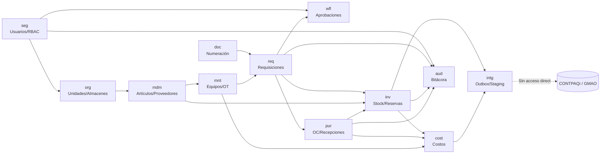
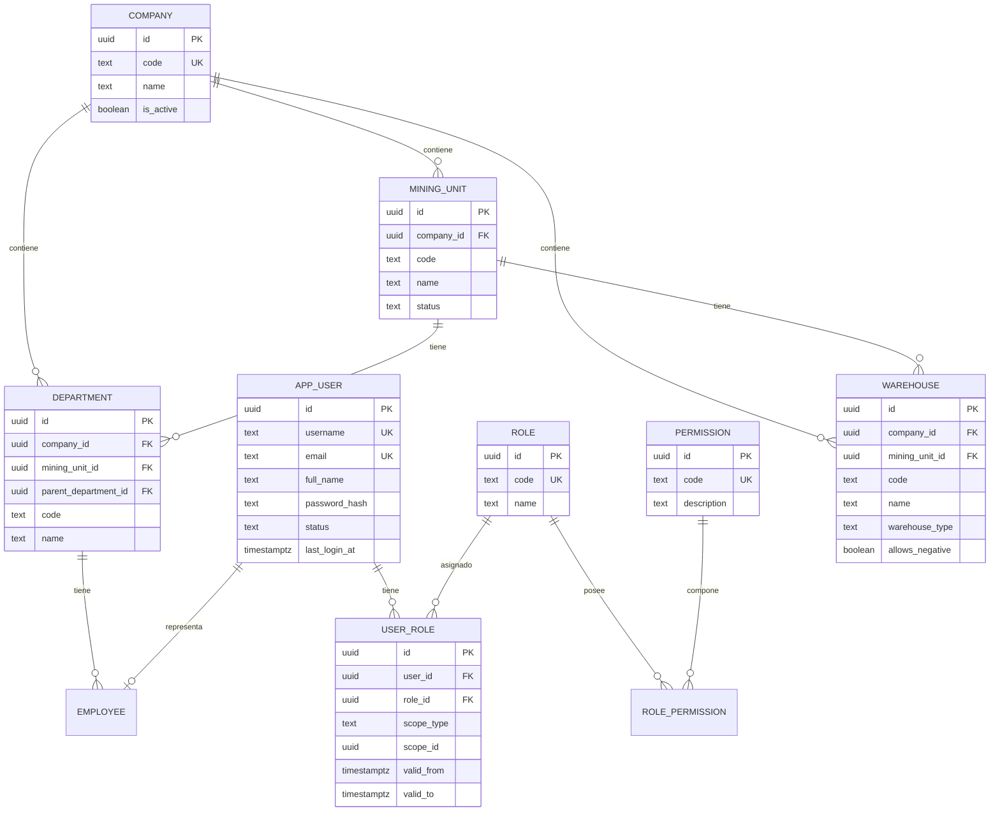
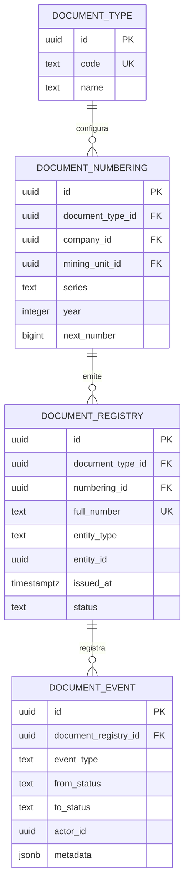
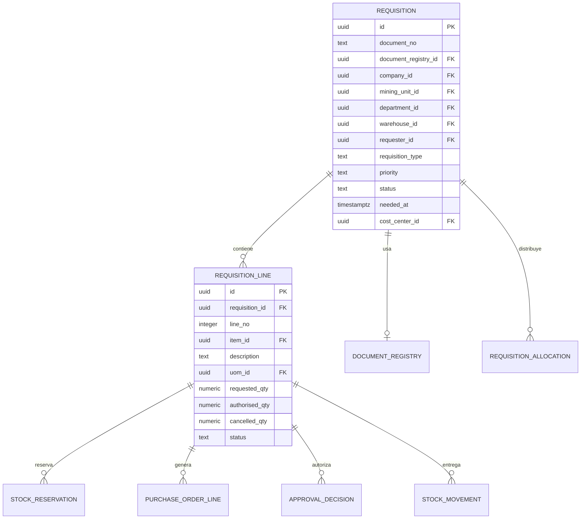
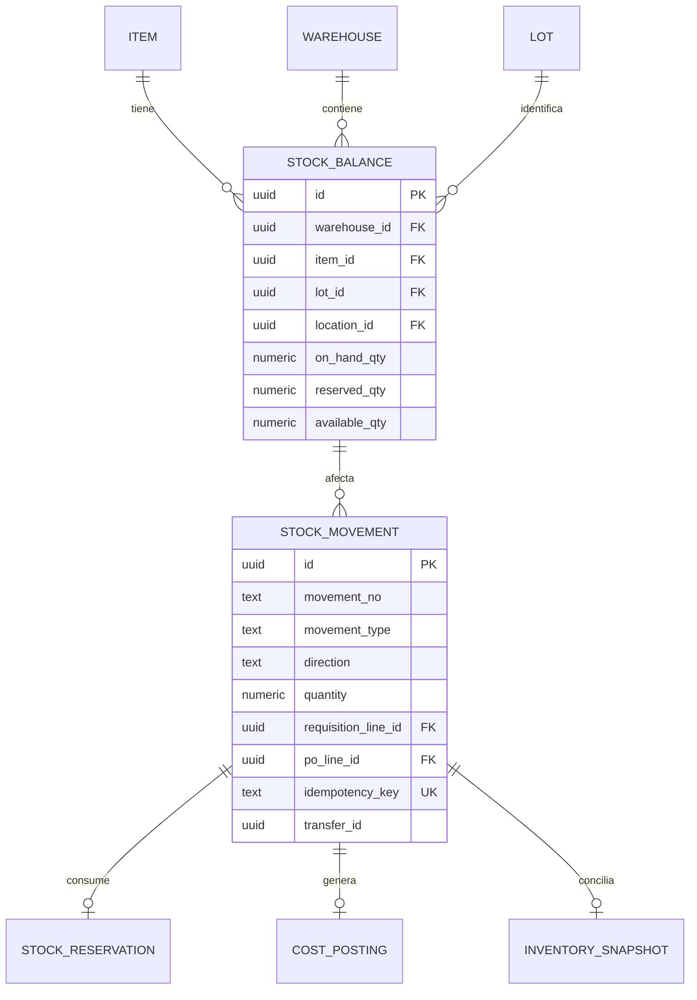
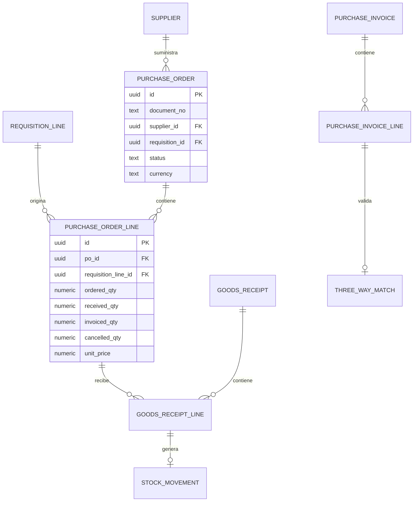
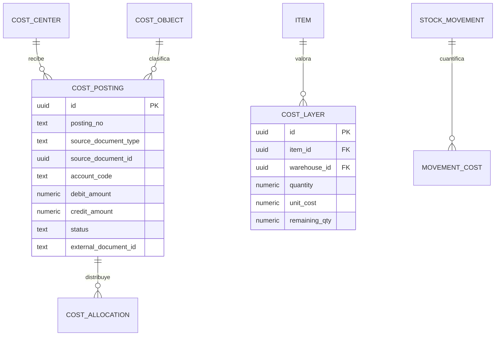

# Modelo de datos — ERP MINERO INTEGRAL

**Versión:** 0.1 (diseño)  
**Fecha:** 2026-11-18  
**Motor:** PostgreSQL 16+  
**Estado:** Propuesta para revisión; aún no existen migraciones ejecutadas.

---

## 1. Convenciones generales

### 1.1 Tipos

| Concepto | Tipo PostgreSQL | Regla |
|---|---|---|
| Identificador técnico | `UUID` | `gen_random_uuid()` vía extensión `pgcrypto` |
| Cantidad | `NUMERIC(18,6)` | Nunca `float`/`double` |
| Importe | `NUMERIC(18,4)` | MXN por defecto;currency explícita en cabecera |
| Porcentaje | `NUMERIC(7,4)` | 0–100 |
| Fecha/hora | `TIMESTAMPTZ` | UTC en almacenamiento; presentación `America/Mexico_City` |
| Fecha sin hora | `DATE` | Solo cuando el concepto no tiene hora |
| Texto largo | `TEXT` | Con validación de longitud en Pydantic |
| Metadatos | `JSONB` | Con índices GIN solo donde se consulte |
| Hash de archivo | `TEXT` | SHA-256 hexadecimal |

### 1.2 Columnas transversales

Toda tabla transaccional incluye:

```text
id                 UUID PRIMARY KEY
created_at         TIMESTAMPTZ NOT NULL DEFAULT now()
created_by         UUID REFERENCES seg.app_user(id)
updated_at         TIMESTAMPTZ
updated_by         UUID REFERENCES seg.app_user(id)
version            INTEGER NOT NULL DEFAULT 1
```

Tablas de hechos (`stock_movement`, `cost_posting`, `audit_log`, `document_event`, `outbox_event`, `inbox_event`) son **inmutables**: no tienen `updated_at`/`version` y no se eliminan.

### 1.3 Reglas de nombres

- Esquema por dominio: `seg`, `org`, `mdm`, `doc`, `req`, `wfl`, `inv`, `pur`, `mnt`, `cost`, `intg`, `aud`.
- Tablas en singular.
- FK: `<tabla>_id`.
- Índices: `ix_<schema>_<tabla>_<columnas>`.
- Restricciones: `ck_<tabla>_<regla>`, `uq_<tabla>_<columnas>`, `fk_<tabla>_<referencia>`.
- Enums PostgreSQL con prefijo `enum_`, o `TEXT` + CHECK si se prefiere flexibilidad. Se recomienda `TEXT` + CHECK para reducir fricción con Alembic.

### 1.4 Política de eliminación

No hay `DELETE` físico en tablas de negocio. Para dar de baja un registro se usan:

- `is_active BOOLEAN DEFAULT true`, o
- `status = 'INACTIVE'/'CANCELLED'`, o
- `valid_to TIMESTAMPTZ` en relaciones temporales.

El único `DELETE` permitido es en datos de staging ya procesados, y solo mediante procedimiento controlado y autorizado.

---

## 2. Diagrama general por dominio



---

## 3. Seguridad y organización

### 3.1 Diagrama



### 3.2 Catálogo

| Tabla | Columnas clave | Restricciones | Propósito |
|---|---|---|---|
| `seg.app_user` | `username`, `email`, `password_hash`, `status`, `timezone` | `username`/`email` únicos; hash nunca en logs | Usuarios del ERP |
| `seg.role` | `code`, `name`, `description` | `code` único | Roles: SOLICITANTE, ALMACENISTA, COMPRADOR, APROBADOR, CONTADOR, ADMIN |
| `seg.permission` | `code`, `description` | `code` único | Permisos granulares |
| `seg.user_role` | `user_id`, `role_id`, `scope_type`, `scope_id`, `valid_from`, `valid_to` | único por usuario/rol/alcance; solapamiento validado en servicio | RBAC con alcance |
| `seg.role_permission` | `role_id`, `permission_id` | PK compuesta | Matriz de permisos |
| `seg.login_audit` | `user_id`, `success`, `reason`, `ip_hash`, `occurred_at` | inmutable | Evidencia de acceso |
| `org.company` | `code`, `name`, `is_active` | `code` único | Empresa (preparación multiempresa) |
| `org.mining_unit` | `company_id`, `code`, `name`, `status` | único `(company_id, code)` | Unidad minera, p. ej. La Guitarra |
| `org.department` | `company_id`, `mining_unit_id`, `parent_department_id`, `code` | único `(company_id, code)` | Departamentos/áreas |
| `org.warehouse` | `company_id`, `mining_unit_id`, `code`, `warehouse_type`, `allows_negative` | único `(company_id, code)` | Almacén principal, superficial, subterráneo, tránsito, scrap |
| `org.employee` | `company_id`, `employee_code`, `user_id`, `department_id`, `status` | único `(company_id, employee_code)` | Solicitantes/responsables |

---

## 4. Datos maestros

| Tabla | Columnas clave | Restricciones | Propósito |
|---|---|---|---|
| `mdm.uom` | `code`, `name`, `precision` | `code` único | Unidades de medida |
| `mdm.item` | `company_id`, `code`, `description`, `item_type`, `uom_id`, `purchase_uom_id`, `lot_tracked`, `serial_tracked`, `valuation_method`, `standard_cost` | único `(company_id, code)`; `item_type` en STOCK/SERVICE/FIXED_ASSET | Artículos y servicios |
| `mdm.item_uom_conversion` | `item_id`, `from_uom_id`, `to_uom_id`, `factor` | único `(item_id, from_uom_id, to_uom_id)`; factor > 0 | Conversiones |
| `mdm.supplier` | `company_id`, `code`, `name`, `payment_terms`, `status` | único `(company_id, code)` | Proveedores |
| `mdm.item_supplier` | `item_id`, `supplier_id`, `supplier_part_number`, `lead_time_days`, `min_order_qty`, `preferred` | PK `(item_id, supplier_id)` | Relación artículo-proveedor |
| `mdm.mining_location` | `mining_unit_id`, `code`, `location_type`, `parent_id`, `description` | único `(mining_unit_id, location_type, code)` | Nivel, tajo, galería, frente |
| `mdm.storage_location` | `warehouse_id`, `code`, `description` | único `(warehouse_id, code)` | Pasillo/anaquel/bin |
| `mdm.lot` | `item_id`, `lot_number`, `expiry_date` | único `(item_id, lot_number)` | Lotes |
| `mdm.serial` | `item_id`, `serial_number`, `status` | único `(item_id, serial_number)` | Series |

Regla: un artículo con `lot_tracked = true` no puede tener movimiento de inventario sin `lot_id`. Igual lógica para `serial_tracked`.

---

## 5. Numeración y trazabilidad documental



| Tabla | Regla crítica |
|---|---|
| `doc.document_type` | Catálogo: `REQ`, `AUTH`, `OC`, `GRN`, `INV_MOV`, `WO`, `ADJ`, `COST_POST` |
| `doc.document_numbering` | Único por `(document_type_id, company_id, mining_unit_id, series, year)`; incremento con `SELECT ... FOR UPDATE` |
| `doc.document_registry` | `full_number` único global; ej. `REQ-LAG-2026-000123` |
| `doc.document_event` | Inmutable; `idempotency_key` único para reintentos |

Cada cabecera de negocio referencia `document_registry_id` y replica `document_no` solo para lectura rápida. El número completo y su secuencia son la fuente de verdad documental.

---

## 6. Requisiciones



### 6.1 `req.requisition`

| Columna | Tipo | Observación |
|---|---|---|
| `id` | UUID PK | |
| `document_no` | TEXT | Copia legible; único vía registry |
| `document_registry_id` | UUID FK UNIQUE | Numeración oficial interna |
| `company_id`, `mining_unit_id`, `department_id` | UUID FK | Alcance organizacional |
| `warehouse_id` | UUID FK nullable | Obligatorio si `requisition_type = STOCK` |
| `requester_id` | UUID FK | `seg.app_user` u `org.employee` según decisión final |
| `requisition_type` | TEXT CHECK | `STOCK`, `PURCHASE`, `SERVICE` |
| `priority` | TEXT CHECK | `LOW`, `NORMAL`, `HIGH`, `URGENT` |
| `status` | TEXT CHECK | Ver máquina de estados |
| `needed_at` | TIMESTAMPTZ | Requerimiento del solicitante |
| `cost_center_id`, `cost_object_id` | UUID FK | Destino de costo por defecto |
| `submitted_at`, `approved_at`, `rejected_at`, `cancelled_at` | TIMESTAMPTZ nullable | Trazabilidad de ciclo |
| `external_ref` | TEXT nullable | Referencia de sistema externo, nunca credencial |

### 6.2 `req.requisition_line`

| Columna | Regla |
|---|---|
| `line_no` | Único dentro de la requisición |
| `item_id` | Obligatorio para STOCK/PURCHASE; nullable para SERVICE genérico |
| `description` | Texto libre para servicios |
| `requested_qty` | > 0 |
| `authorised_qty` | 0 ≤ valor ≤ `requested_qty - cancelled_qty`; se actualiza solo desde decisiones aprobadas |
| `cancelled_qty` | ≥ 0 y ≤ `requested_qty` |
| `status` | `OPEN`, `PARTIAL`, `AUTHORISED`, `CANCELLED`, `CLOSED` |

### 6.3 `req.requisition_allocation`

Distribución opcional por línea o cabecera hacia centros/objetos de costo. Suma de `percentage` = 100 por línea asignada.

### 6.4 Vista de cantidades controladas

```sql
CREATE VIEW req.v_requisition_line_quantities AS
SELECT
    rl.id AS requisition_line_id,
    rl.requested_qty,
    rl.authorised_qty,
    rl.cancelled_qty,
    COALESCE(SR.reserved_qty, 0)  AS reserved_qty,
    COALESCE(PO.purchased_qty, 0) AS purchased_qty,
    COALESCE(GR.received_qty, 0)  AS received_qty,
    COALESCE(MV.delivered_qty, 0) AS delivered_qty,
    rl.requested_qty
      - rl.cancelled_qty
      - COALESCE(MV.delivered_qty, 0) AS pending_qty
FROM req.requisition_line rl
LEFT JOIN (
    SELECT requisition_line_id, SUM(quantity) AS reserved_qty
    FROM inv.stock_reservation
    WHERE status = 'ACTIVE' AND expires_at > now()
    GROUP BY requisition_line_id
) SR ON SR.requisition_line_id = rl.id
LEFT JOIN (
    SELECT requisition_line_id, SUM(ordered_qty - cancelled_qty) AS purchased_qty
    FROM pur.purchase_order_line
    GROUP BY requisition_line_id
) PO ON PO.requisition_line_id = rl.id
LEFT JOIN (
    SELECT pol.requisition_line_id, SUM(grl.quantity) AS received_qty
    FROM pur.goods_receipt_line grl
    JOIN pur.purchase_order_line pol ON pol.id = grl.po_line_id
    GROUP BY pol.requisition_line_id
) GR ON GR.requisition_line_id = rl.id
LEFT JOIN (
    SELECT requisition_line_id, SUM(quantity) AS delivered_qty
    FROM inv.stock_movement
    WHERE movement_type = 'ISSUE' AND status = 'POSTED'
    GROUP BY requisition_line_id
) MV ON MV.requisition_line_id = rl.id;
```

Reglas derivadas:

- `delivered_qty` y `reserved_qty` no pueden solaparse para la misma cantidad: al entregar se consume la reserva.
- `received_qty` incrementa stock pero **no** incrementa `delivered_qty`; son etapas distintas.
- Una línea se cierra cuando `delivered_qty + received_qty >= authorised_qty` según su tipo.

---

## 7. Workflow y autorizaciones

| Tabla | Columnas clave | Regla |
|---|---|---|
| `wfl.approval_policy` | `code`, `document_type`, `conditions JSONB`, `is_active` | Define cuándo aplica |
| `wfl.approval_policy_step` | `policy_id`, `step_no`, `role_id`, `approver_user_id`, `min_amount`, `max_amount`, `require_all`, `sla_hours` | Orden determinista |
| `wfl.approval_request` | `document_type`, `document_id`, `policy_id`, `status`, `current_step_no` | Una solicitud activa por documento |
| `wfl.approval_step` | `approval_request_id`, `step_no`, `role_id`, `status`, `due_at`, `acted_at` | Un paso por rol/orden |
| `wfl.approval_decision` | `approval_step_id`, `requisition_line_id`, `decision`, `approved_qty`, `comment` | Único por paso+línea; `approved_qty ≥ 0` |
| `wfl.approval_delegation` | `from_user_id`, `to_user_id`, `start_at`, `end_at` | No se permite solapamiento para el mismo usuario |
| `wfl.document_event` | `document_registry_id`, `event_type`, `from_status`, `to_status`, `actor_id` | Inmutable, con hash de metadata |

### 7.1 Reglas

1. `SUM(approved_qty)` por línea no puede exceder `requested_qty - cancelled_qty`.
2. Una decisión `REJECT` implica `approved_qty = 0` para esa línea en ese paso.
3. Solo decisiones de pasos `APPROVED` cuentan para `authorised_qty`.
4. La delegación se valida contra `start_at`/`end_at` en el momento de decidir.
5. Cambiar una decisión después de crear reservas o recepciones está prohibido; se requiere reversión documentada.

---

## 8. Inventario operativo



### 8.1 `inv.stock_balance`

- PK compuesta lógica: `(warehouse_id, item_id, lot_id, nullable location_id)` con UNIQUE. En PostgreSQL 15+ usar `NULLS NOT DISTINCT`; si no, columnas sentinel UUID.
- `available_qty` se calcula como `on_hand_qty - reserved_qty`, expuesto en vista y validado por CHECK.
- `allows_negative = false` en almacén impide `available_qty < 0`.
- Se bloquea con `SELECT ... FOR UPDATE` antes de cualquier cambio.

### 8.2 `inv.stock_movement`

| Columna | Regla |
|---|---|
| `movement_no` | Número de documento `INV_MOV` |
| `movement_type` | `RECEIPT`, `ISSUE`, `TRANSFER_OUT`, `TRANSFER_IN`, `ADJUSTMENT_IN`, `ADJUSTMENT_OUT`, `RETURN`, `REVERSAL` |
| `direction` | `IN` / `OUT` coherente con `movement_type` |
| `quantity` | > 0; el signo lo da `direction` |
| `source_document_type`, `source_document_id`, `source_line_id` | Trazabilidad polimórfica indexada |
| `requisition_line_id`, `po_line_id`, `work_order_id` | FK opcionales según origen |
| `transfer_id` | UUID común para ambos lados de una transferencia |
| `idempotency_key` | Único; preferible `SHA256(tenant|source_type|source_id|line_id|movement_type|attempt)` |
| `reversal_of_id` | FK a movimiento original para contrapartidas |
| `external_system_id`, `external_document_id` | Nullable; evidencia de conciliación |
| `status` | `POSTED`, `REVERSED` |
| `posted_at`, `occurred_at` | Trazabilidad temporal |

### 8.3 `inv.stock_reservation`

| Columna | Regla |
|---|---|
| `requisition_line_id`, `work_order_id` | Al menos uno debe estar presente |
| `item_id`, `warehouse_id`, `lot_id`, `location_id` | Definen saldo reservado |
| `quantity` | > 0 |
| `status` | `ACTIVE`, `CONSUMED`, `RELEASED`, `EXPIRED` |
| `expires_at` | Obligatorio; expiración libera automáticamente por job local |
| `idempotency_key` | Único para evitar doble reserva por reintento |

### 8.4 Ajustes, snapshots y conciliación

| Tabla | Propósito |
|---|---|
| `inv.stock_adjustment` | Cabecera de conteo/ajuste con motivo y aprobación |
| `inv.stock_adjustment_line` | `counted_qty`, `system_qty`, `difference_qty`, `movement_id` |
| `inv.inventory_snapshot` | Foto operativa u oficial por sistema, almacén, artículo y lote |
| `inv.inventory_reconciliation` | Comparación de snapshots, estado y diferencias |
| `inv.inventory_reconciliation_line` | Detalle por artículo/lote con `difference_qty` y resolución |
| `intg.external_system` | Registro de sistemas; `official_inventory = true` solo CONTPAQi |

Regla crítica: un ajuste nunca modifica un movimiento anterior; crea un movimiento `ADJUSTMENT_IN/OUT` con `reversal_of_id` si corrige otro.

---

## 9. Compras



### 9.1 Tablas

| Tabla | Columnas clave | Reglas |
|---|---|---|
| `pur.purchase_order` | `document_no`, `supplier_id`, `requisition_id`, `buyer_id`, `status`, `currency`, `expected_at`, `approved_at` | Solo `APPROVED` puede enviarse |
| `pur.purchase_order_line` | `po_id`, `line_no`, `requisition_line_id`, `item_id`, `ordered_qty`, `received_qty`, `invoiced_qty`, `cancelled_qty`, `unit_price` | `received_qty ≤ ordered_qty - cancelled_qty + tolerance_qty` |
| `pur.goods_receipt` | `document_no`, `po_id`, `warehouse_id`, `received_at`, `received_by`, `status` | Requiere OC aprobada/enviada |
| `pur.goods_receipt_line` | `grn_id`, `po_line_id`, `quantity`, `lot_id`, `serial_id`, `inspection_status`, `movement_id` | Cada línea genera un movimiento de entrada |
| `pur.purchase_invoice` | `invoice_no`, `supplier_id`, `po_id`, `total_amount`, `status`, `external_document_id` | No se conecta a CONTPAQi; solo referencia |
| `pur.purchase_invoice_line` | `invoice_id`, `po_line_id`, `quantity`, `unit_price`, `tax_amount`, `matched_status` | Cubre cantidad/importe de recepción |
| `pur.three_way_match` | `invoice_line_id`, `po_line_id`, `grn_line_id`, `difference_qty`, `difference_amount`, `status` | `MATCHED`, `TOLERANCE`, `BLOCKED` |
| `pur.purchase_tolerance` | `company_id`, `document_type`, `qty_pct`, `amount_pct`, `requires_approval` | Configurable por empresa |

### 9.2 Reglas

- Una línea de OC puede originarse de una o varias líneas de requisición, pero una línea de requisición no puede comprometer más de su `authorised_qty` salvo tolerancia aprobada.
- La recepción incrementa `received_qty` de la OC y crea movimiento de inventario y capa de costo en la misma transacción.
- La factura no modifica stock; solo participa en triple match y costos cuando corresponda.
- Una diferencia fuera de tolerancia bloquea el cierre y requiere aprobación.

---

## 10. Equipos y mantenimiento

| Tabla | Columnas clave | Regla |
|---|---|---|
| `mnt.equipment` | `company_id`, `mining_unit_id`, `asset_tag`, `serial_number`, `equipment_type`, `criticality`, `status`, `cost_center_id`, `parent_equipment_id`, `external_gmao_id` | `asset_tag` único por empresa |
| `mnt.equipment_meter` | `equipment_id`, `meter_code`, `unit`, `current_value` | Único por equipo+código |
| `mnt.equipment_meter_reading` | `meter_id`, `value`, `reading_at`, `source`, `external_gmao_id` | Inmutable; valores no decrecientes salvo corrección |
| `mnt.maintenance_work_order` | `wo_no`, `equipment_id`, `type`, `priority`, `status`, `planned_start`, `actual_start`, `assigned_to`, `cost_center_id`, `external_gmao_id` | Solo transiciones definidas |
| `mnt.work_order_task` | `wo_id`, `sequence`, `description`, `status` | Orden único por OT |
| `mnt.work_order_material` | `wo_id`, `requisition_line_id`, `movement_id`, `item_id`, `quantity` | Consumo vinculado a movimiento real |
| `mnt.maintenance_plan` | `equipment_id`, `interval_value`, `interval_uom`, `next_due_at` | Genera sugerencia de OT, no ejecución automática |
| `intg.gmao_sync_event` | `entity_type`, `entity_id`, `external_gmao_id`, `direction`, `status`, `payload_hash` | Sin credenciales ni acceso directo |

Estados de OT: `DRAFT → PLANNED → IN_PROGRESS → WAITING_PARTS → COMPLETED → CLOSED`, con `CANCELLED` desde estados previos a `COMPLETED`.

---

## 11. Costos



### 11.1 Tablas

| Tabla | Regla |
|---|---|
| `cost.cost_center` | Único por `(company_id, code)`; jerarquía con `parent_id` |
| `cost.cost_object` | Tipos: `WORK_ORDER`, `MINING_LOCATION`, `PROJECT`, `SHIFT` |
| `cost.cost_posting` | Inmutable; asiento operativo con `source_document_type/id`, `account_code`, montos, estado y referencia externa |
| `cost.cost_allocation` | Suma de porcentajes = 100 por asiento |
| `cost.cost_layer` | Capa FIFO / promedio; `remaining_qty ≥ 0` |
| `inv.stock_movement_cost` | relaciona movimiento con capas y `unit_cost` |
| `cost.cost_exchange_rate` | Solo si se requiere multi-moneda; inicialmente MXN |

### 11.2 Reglas

- Todo consumo de inventario genera un `cost_posting` en la misma transacción del movimiento.
- Las reversiones son nuevos asientos con `reversal_of_id`; nunca se actualiza el original.
- `external_document_id` se llena solo después de conciliación autorizada con CONTPAQi.
- El ERP no calcula impuestos fiscales oficiales en esta etapa; esa responsabilidad permanece en CONTPAQi.

---

## 12. Integraciones, eventos y auditoría

| Tabla | Regla |
|---|---|
| `intg.external_system` | Catálogo; `official_inventory = true` únicamente para CONTPAQi |
| `intg.external_mapping` | Mapeo entre ID interno y clave externa; único por sistema+tipo+ID |
| `intg.integration_batch` | Archivo/fuente, `file_name`, `sha256`, `status`, `created_by` |
| `intg.integration_staging` | `payload JSONB`, validación y error por fila |
| `intg.outbox_event` | Evento transaccional; `aggregate_type`, `aggregate_id`, `event_type`, `payload`, `status` |
| `intg.inbox_event` | `event_id` único para idempotencia de entrada |
| `aud.audit_log` | Inmutable; actor, acción, entidad, antes/después, `request_id`, `correlation_id`, `ip_hash` |
| `aud.data_export_log` | Registra exportaciones y su destino autorizado |

---

## 13. Máquinas de estado

### 13.1 Requisición

```text
DRAFT ──submit──> SUBMITTED ──approve──> APPROVED ──issue/receive──> IN_PROGRESS ──close──> CLOSED
  │                  │                     │
  ├──cancel──> CANCELLED              ├──partial──> PARTIALLY_APPROVED
  │                  │                     │
  └──delete──> NO    └──reject──> REJECTED └──reject──> REJECTED
```

Reglas:

- No se puede enviar una requisición sin líneas.
- No se puede autorizar una cantidad mayor a la solicitada.
- No se puede entregar ni comprar si no está `APPROVED` o `PARTIALLY_APPROVED`.
- `CANCELLED` solo libera reservas activas; no revierte movimientos ya publicados.

### 13.2 Orden de compra

```text
DRAFT → APPROVED → SENT → PARTIALLY_RECEIVED → RECEIVED → CLOSED
                ↘ CANCELLED
```

### 13.3 Recepción, movimiento y asiento

```text
DRAFT → POSTED → REVERSED
```

`REVERSED` no borra el registro; crea uno nuevo con signo opuesto.

---

## 14. Reglas transaccionales críticas

### 14.1 Reservar stock para una requisición

```text
BEGIN
  lock requisition_line FOR UPDATE
  validate status in (APPROVED, PARTIALLY_APPROVED)
  validate authorised_qty - delivered_qty >= requested_reserve_qty
  lock stock_balance FOR UPDATE  (warehouse, item, lot, location)
  validate available_qty >= requested_reserve_qty
  insert stock_reservation(idempotency_key=...)
  update stock_balance.reserved_qty += requested_reserve_qty
  insert audit_log + outbox_event
COMMIT
```

### 14.2 Entregar stock reservado

```text
BEGIN
  lock reservation FOR UPDATE
  validate status = ACTIVE
  lock stock_balance FOR UPDATE
  consume reservation (status=CONSUMED)
  stock_balance.on_hand_qty -= qty
  stock_balance.reserved_qty -= qty
  insert stock_movement(ISSUE, idempotency_key=...)
  insert stock_movement_cost from cost layers
  insert cost_posting(DEBIT = work order/cost center)
  insert audit_log + outbox_event
COMMIT
```

### 14.3 Recibir compra

```text
BEGIN
  lock purchase_order_line FOR UPDATE
  validate received_qty + qty <= ordered_qty - cancelled_qty + tolerance
  lock/upsert stock_balance FOR UPDATE
  stock_balance.on_hand_qty += qty
  insert stock_movement(RECEIPT)
  insert cost_layer(remaining_qty=qty, unit_cost=invoice or PO price)
  update purchase_order_line.received_qty += qty
  insert cost_posting if policy requires
  insert audit_log + outbox_event
COMMIT
```

### 14.4 Transferencia entre almacenes

```text
BEGIN
  lock balances in deterministic order by balance.id
  validate available_qty in source
  source.on_hand_qty -= qty
  destination.on_hand_qty += qty
  insert two stock_movement rows with same transfer_id
  insert audit_log + outbox_event
COMMIT
```

### 14.5 Reintentos y errores

- Violación de `idempotency_key`: devolver el resultado original, no error al usuario.
- Error `400/422`: no reintentar; corregir solicitud.
- Deadlock / `40001`: reintentar transacción hasta 3 veces con backoff corto.
- Cualquier otro error: rollback y registrar correlación.

---

## 15. Índices recomendados

```text
ix_inv_stock_balance_unique        (warehouse_id, item_id, lot_id, location_id) UNIQUE
ix_inv_stock_movement_source       (source_document_type, source_document_id)
ix_inv_stock_movement_req_line     (requisition_line_id) WHERE movement_type='ISSUE'
ix_inv_stock_movement_idem         (idempotency_key) UNIQUE
ix_inv_reservation_active          (requisition_line_id) WHERE status='ACTIVE'
ix_req_line_requisition            (requisition_id, line_no) UNIQUE
ix_pur_pol_req_line                (requisition_line_id)
ix_pur_grl_po_line                 (po_line_id)
ix_cost_posting_source             (source_document_type, source_document_id)
ix_audit_log_entity                (entity_type, entity_id, occurred_at DESC)
ix_outbox_pending                  (status, available_at) WHERE status='PENDING'
ix_intg_batch_status               (external_system_id, status, started_at DESC)
```

---

## 16. Datos semilla sintéticos

Se crearán solo datos ficticios, por ejemplo:

- Empresa `EMP_DEMO`, unidad `LAG_DEMO`, almacén `ALM_PRINCIPAL_DEMO`.
- Usuarios `demo.solicitante`, `demo.almacenista`, `demo.aprobador`, `demo.comprador`, `demo.admin`.
- Artículos `DEMO-TORNILLO`, `DEMO-ACEITE`, `DEMO-FILTRO`.
- Equipo `EQ-DEMO-001`.
- Centro de costo `CC-DEMO-MINA`.

Ningún nombre, código, proveedor, precio, existencia o artículo corresponderá a información real de La Guitarra sin autorización.

---

## 17. Verificación del modelo

Antes de dar por terminada una migración:

1. `alembic upgrade head` desde base vacía.
2. Consulta de restricciones (`information_schema`) comparada con este documento.
3. Prueba de unicidad de numeración concurrente.
4. Prueba de sobre-reserva rechazada.
5. Prueba de entrega con reserva consume reserva y no duplica stock.
6. Prueba de recepción actualiza OC, stock y capa de costo en una sola transacción.
7. Prueba de rollback: si falla el asiento de costo, no queda movimiento de stock.
8. Prueba de idempotencia: repetir la misma clave no duplica filas.
9. Revisión de diff sin secretos ni datos reales.
